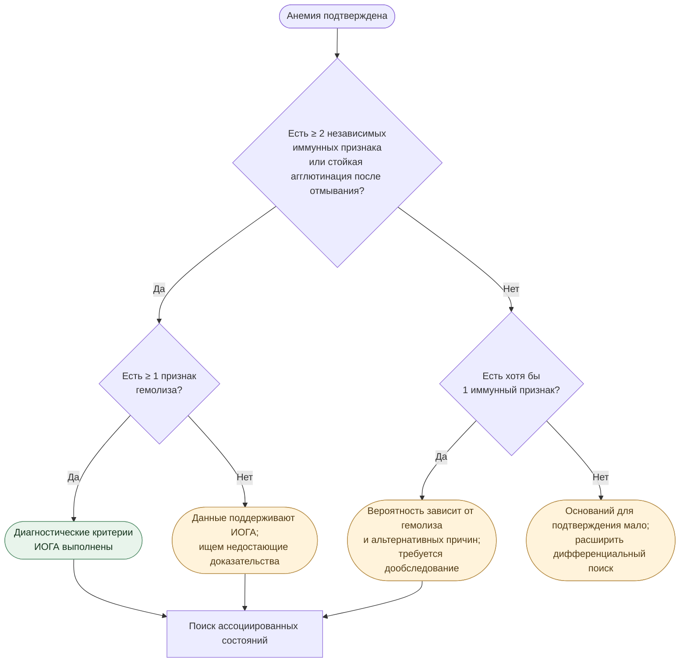
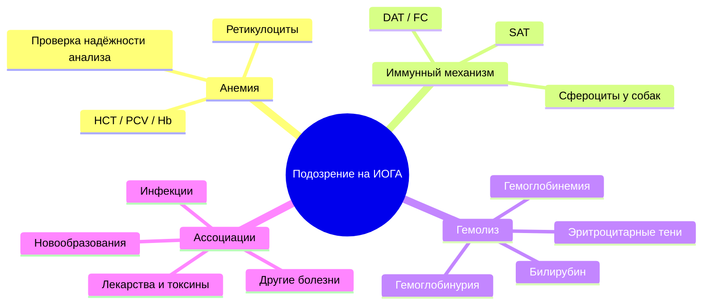

# ИОГА у собак и кошек

### Урок 01 · Патофизиология и доказательная логика диагностики

> **Клиническая задача урока:** научиться отделять **факт анемии**, **признаки гемолиза** и **доказательства иммунного механизма**, а затем формулировать диагноз с корректной степенью уверенности.
>
> **Основа:** консенсус ACVIM по диагностике ИОГА собак и кошек (Garden et al., 2019) [1], материалы клинической патологии Cornell eClinpath [2–4].
>
> **Версия конспекта:** 28 октября 2026 г. · **Формат:** Markdown с навигацией, Mermaid-схемами, раскрывающимися ответами и рабочим диагностическим чек-листом.

[**Короткая памятка**](#quick-reference) · [**Диагностический алгоритм**](#algorithm) · [**Клинические случаи**](#cases) · [**Самопроверка**](#practice) · [**Источники**](#sources)

---

<a id="contents"></a>
## Содержание

1. [Цель урока и четыре диагностических вопроса](#goals)
2. [Определение ИОГА и механизм разрушения эритроцитов](#pathophysiology)
3. [Анемия: три возможных механизма](#anemia)
4. [Как устроено доказательство ИОГА по ACVIM](#algorithm)
5. [Лабораторные признаки и ограничения](#markers)
   - [Ретикулоциты и регенерация](#reticulocytes)
   - [Сфероциты](#spherocytes)
   - [Агглютинация и SAT](#sat)
   - [DAT — прямая проба Кумбса](#dat)
   - [Маркеры гемолиза](#hemolysis)
6. [Собаки и кошки: различия диагностического подхода](#species)
7. [Поиск ассоциированных состояний](#associated)
8. [Два полностью разобранных случая](#cases)
9. [Антипримеры: распространённые диагностические ошибки](#pitfalls)
10. [Пограничные ситуации](#edge-cases)
11. [Словарь и концептуальная карта](#glossary)
12. [Памятка клинициста и шаблон разбора](#quick-reference)
13. [Самопроверка с раскрывающимися ответами](#practice)
14. [Источники и иллюстративные материалы](#sources)

---

<a id="goals"></a>
## 1. Цель урока: четыре диагностических вопроса

К концу темы Вы должны понимать, **что именно доказывает каждый лабораторный признак**, и уметь аргументировать степень уверенности в диагнозе.

1. **Есть ли анемия?** Оценить гематокрит, гемоглобин, число эритроцитов и достоверность результатов.
2. **Есть ли гемолиз?** Найти свидетельства патологического разрушения эритроцитов.
3. **Есть ли иммунный механизм?** Выявить агглютинацию, сфероцитоз у собак, антитела или комплемент на поверхности эритроцитов.
4. **С чем связано заболевание?** Искать инфекции, токсические воздействия, лекарственные факторы, новообразования и другие возможные ассоциации.

**Ключевая формула мышления:**

> **Анемия + убедительные иммунные маркеры + доказательство гемолиза → обоснованное заключение об ИОГА.**
>
> Конкретный порог достаточности уточняется алгоритмом ACVIM; комбинации менее убедительных результатов требуют осторожной формулировки [1].

<a id="pathophysiology"></a>
## 2. Что происходит при ИОГА

**Иммуноопосредованная гемолитическая анемия** (*immune-mediated hemolytic anemia*, **IMHA**, рус. **ИОГА**) — состояние, при котором иммунные механизмы вызывают преждевременное разрушение циркулирующих эритроцитов и снижение их массы.

Эритроцит переносит кислород посредством гемоглобина. В норме стареющие эритроциты постепенно удаляются из циркуляции, а костный мозг компенсирует потери. При ИОГА скорость удаления или разрушения клеток патологически возрастает.

В основе могут лежать антитела к поверхностным структурам эритроцитов, участие рецепторов макрофагов к Fc-фрагментам антител и активация **комплемента** — системы белков врождённого иммунитета [1].

### Два основных пути гемолиза

```mermaid
flowchart TD
    A[Антитела связываются<br/>с поверхностью эритроцита] --> B{Преобладающий механизм}
    B --> C[Распознавание макрофагами<br/>селезёнки и печени]
    B --> D[Активация комплемента<br/>и повреждение мембраны]
    C --> E[Внесосудистый гемолиз]
    D --> F[Внутрисосудистый гемолиз]
    E --> G[Удаление эритроцитов;<br/>возможный сфероцитоз]
    F --> H[Свободный гемоглобин<br/>в плазме и иногда моче]
    G --> I[Анемия ± гипербилирубинемия]
    H --> I
    classDef mech fill:#eaf1fb,stroke:#6480a5,color:#17263c;
    classDef end fill:#f7ece9,stroke:#b78776,color:#41291f;
    class A,B,C,D mech;
    class E,F,G,H,I end;
```

#### Внесосудистый гемолиз

Макрофаги преимущественно в селезёнке и печени распознают опсонизированные — покрытые антителами и/или компонентами комплемента — эритроциты. Они могут:

- полностью фагоцитировать эритроцит;
- удалить часть мембраны, после чего клетка становится более округлой и плотной — **сфероцитом**.

Разрушение гемоглобина увеличивает образование билирубина. Когда его образование превосходит способность организма к обработке и выведению или сочетается с другими нарушениями, возможны **гипербилирубинемия** и **желтуха**.

#### Внутрисосудистый гемолиз

При некоторых вариантах иммунного повреждения комплемент формирует мембраноатакующий комплекс, способный разрушить эритроцит внутри сосудистого русла. Тогда гемоглобин поступает непосредственно в плазму, вызывая **гемоглобинемию**; при достаточной выраженности процесса может возникнуть **гемоглобинурия**.

> **Важно:** оба пути способны сосуществовать. Наличие или отсутствие тёмной мочи не определяет само по себе наличие ИОГА.

<a id="anemia"></a>
## 3. Анемия: что снизило массу эритроцитов?

**Анемия** — уменьшение эритроцитарной массы, отражающееся обычно снижением гемоглобина и гематокрита относительно подходящих для вида и лаборатории интервалов.

| Механизм | Что нарушено | Пример | На что обратить внимание |
|---|---|---|---|
| **Кровопотеря** | Эритроциты выходят из кровотока | Желудочно-кишечное или внутреннее кровотечение | История травмы, мелена, УЗИ, гемостаз |
| **Снижение продукции** | Костный мозг выпускает недостаточно клеток | Заболевание костного мозга, хроническая болезнь | Ретикулоциты, другие клеточные линии, длительность процесса |
| **Гемолиз** | Эритроциты разрушаются раньше срока | ИОГА, бабезиоз, окислительное повреждение | Билирубин, свободный гемоглобин, мазок, иммунные тесты |

Низкий гематокрит **фиксирует проблему**, но не определяет её механизм. Кроме того, при выраженной агглютинации автоматический расчёт HCT может быть некорректным; полезна проверка **PCV** — центрифугированного гематокрита — и сопоставление с мазком крови [1].

<a id="algorithm"></a>
## 4. Что нужно доказать: логика ACVIM

Консенсус ACVIM 2019 предлагает оценивать последовательно:

**I. Анемию → II. иммунные маркеры → III. признаки гемолиза → IV. возможные ассоциации и причины.**

### Иммунные маркеры

Клинически значимыми в диагностическом алгоритме считаются:

- **Выраженный сфероцитоз** — *только у собак*;
- **положительный SAT** (солевой тест на агглютинацию) без отмывания;
- **положительный DAT** (прямая проба Кумбса) **или** положительная проточная цитометрия, выявляющая антитела/комплемент на эритроцитах.

**Исключение по силе доказательства:** агглютинация, сохраняющаяся после **трёхкратного отмывания** эритроцитов, может самостоятельно удовлетворять критерию иммунного механизма при подтверждённых анемии и гемолизе [1].

> **Правило подтверждённой ИОГА:** выявлена анемия **и** как минимум **два признака иммунного разрушения** из указанных групп (либо стойкая агглютинация после отмывания) **и** как минимум **один признак гемолиза** [1].

Здесь **DAT и проточная цитометрия выступают альтернативными способами выявления связанного с эритроцитами иммунного материала**, поэтому механическое сложение этих двух результатов как независимых иммунных признаков следует избегать.

### Наглядная схема



*Схема — учебное представление диагностической логики Figure 2 из ACVIM [1], с укрупнёнными ветвями при неполных данных. Строгую классификацию конкретной комбинации необходимо сверять с оригинальной Figure 2.*

### Как формулировать итог

| Уровень доказательств | Корректная формулировка |
|---|---|
| Выполнены основные критерии ACVIM | «Данные соответствуют диагностическим критериям ИОГА» |
| Иммунные признаки есть, но доказательство гемолиза или второй маркер отсутствуют | «Данные поддерживают гипотезу ИОГА, необходимы дополнительные исследования» |
| Есть только анемия или неспецифические изменения | «Причина анемии требует дальнейшего установления» |

**Неопределённость следует описывать явно.** Снижение или повышение диагностической уверенности определяется качеством совокупных данных, а также возможными альтернативными объяснениями.

<a id="markers"></a>
## 5. Лабораторные показатели: что именно они доказывают

| Показатель | Диагностическая роль | Основное ограничение |
|---|---|---|
| **HCT / PCV / Hb** | Подтверждение и оценка анемии | Не устанавливают её причину |
| **Ретикулоциты** | Регенераторный ответ костного мозга | На ранней стадии ответ может запаздывать |
| **Сфероциты** | Признак иммунного разрушения **у собак** | Возможны другие причины и морфологические артефакты |
| **SAT** | Подтверждение агглютинации | Требует исключения rouleaux и технических ошибок |
| **DAT** | Антитела/комплемент на эритроцитах | Отрицательный тест не исключает ИОГА |
| **Проточная цитометрия** | Дополнительный метод обнаружения связанных иммунных факторов | Зависит от методики и лаборатории |
| **Билирубин / иктеричность** | Поддерживают гемолиз при отсутствии альтернатив | Возможны печёночная патология, холестаз и сепсис |
| **Гемоглобинемия / гемоглобинурия** | Поддерживают внутрисосудистый гемолиз | Нужно исключать гемолиз пробы и гематурию |
| **Эритроцитарные тени (ghost cells)** | Возможный признак лизиса | Иногда артефакт приготовления мазка |

<a id="reticulocytes"></a>
### 5.1. Ретикулоциты: отвечает ли костный мозг?

**Ретикулоцит** — молодой эритроцит, сохранивший остаточную рибосомальную РНК. Повышение количества ретикулоцитов говорит о стимуляции эритропоэза — производства эритроцитов.

При гемолизе и кровопотере костный мозг обычно пытается восполнить потерю клеток. Но этому требуется время: выраженный ретикулоцитарный ответ может развиться лишь через **3–5 дней** после острого события. По данным ACVIM, приблизительно **30% собак с ИОГА** при первом обращении не имеют явного регенераторного ответа [1].

Отсюда два правила:

1. **Ретикулоцитоз подтверждает ответ костного мозга; сам по себе не доказывает гемолиз или иммунный механизм.**
2. **Отсутствие ретикулоцитоза при первичном исследовании не исключает ИОГА.** Учитывают срок заболевания, сопутствующие нарушения и динамику.

#### Почему абсолютное количество лучше одного процента

Доля ретикулоцитов зависит от числа всех эритроцитов. При выраженной анемии процент может выглядеть высоким даже при недостаточном абсолютном ответе. Поэтому предпочтительна оценка **абсолютного количества** и его адекватности тяжести анемии [3].

При известных единицах:

```text
Ретикулоциты, клеток/мкл = RBC (млн/мкл) × RET (%) × 10 000
```

**Пример:** RBC = 2,5 млн/мкл и RET = 8% дают `2,5 × 8 × 10 000 = 200 000/мкл`. Клиническую оценку регенерации выполняют по лабораторным интервалам с учётом степени анемии.

**Для кошек важны агрегатные ретикулоциты.** Они отражают недавнюю активность костного мозга. Пунктатные (точечные) ретикулоциты сохраняются дольше и хуже характеризуют текущий ответ [3, 4].

<a id="spherocytes"></a>
### 5.2. Сфероциты: почему уменьшается центральное просветление?

Обычный эритроцит собаки — двояковогнутый диск. Когда макрофаг удаляет часть мембраны, площадь клеточной поверхности снижается относительно объёма. Клетка приобретает сферическую форму, становится визуально плотной и теряет привычное центральное просветление.

**Типичные признаки сфероцита у собаки:**

- форма более округлая;
- насыщенная окраска;
- уменьшенное или отсутствующее центральное просветление;
- часто меньший диаметр по сравнению с обычными эритроцитами.

В мазке крови собак **выраженный** сфероцитоз — весомое свидетельство иммунного повреждения. Однако сфероцитоподобные клетки встречаются и после трансфузии, при окислительном повреждении, микроангиопатии и некоторых других состояниях; необходимо оценивать **хорошо подготовленный монослой** мазка [1, 2].

**У кошек сфероцитоз как диагностический критерий применять нельзя:** эритроциты кошек физиологически имеют менее выраженное центральное просветление, и надёжно отличить сфероциты затруднительно [1].

**Микрофотографии для изучения:** [eClinpath — ИОГА у собаки, много сфероцитов](https://eclinpath.com/hematology/anemia/causes-of-anemia/immune-mediated-hemolytic-anemia-in-a-dog/) [2].

<a id="sat"></a>
### 5.3. SAT: истинная агглютинация или монетные столбики?

**Агглютинация** — образование скоплений эритроцитов, в том числе при связывании клеток антителами. Она может обнаруживаться визуально или микроскопически.

**Rouleaux** (*монетные столбики*) — относительно упорядоченные цепочки эритроцитов, напоминающие стопки монет. Особенно заметны у кошек и при изменениях белкового состава плазмы.

| Признак | Rouleaux | Истинная агглютинация |
|---|---|---|
| Типичное расположение | Упорядоченные «стопки монет» | Нерегулярные скопления |
| Реакция на достаточное разведение физиологическим раствором | Обычно распадаются | Могут сохраняться |
| Диагностический вывод | Не подтверждают иммунное связывание клеток | Поддерживают иммунный механизм при корректно выполненном тесте |

**SAT** (*saline agglutination test*) — солевой тест на агглютинацию. В консенсусе ACVIM для обычной оценки описано смешивание **1 части крови с 4 частями физиологического раствора**. Если результат сомнительный, при выраженных rouleaux или повышении белков рекомендуют дополнительную проверку агглютинации после **трёхкратного отмывания** эритроцитов [1].

> **Не смешивайте критерии:** обычный положительный SAT — один из иммунных маркеров; **агглютинация, сохраняющаяся после трёхкратного отмывания**, обладает особой доказательной ценностью в диагностическом алгоритме [1].

Самостоятельное проведение исследований и интерпретация проб требуют лабораторных навыков, правильной температуры и качества образца. В этом уроке основная цель — понимать, что доказывает результат.

<a id="dat"></a>
### 5.4. DAT — прямая проба Кумбса

**DAT** (*direct antiglobulin test*, прямой антиглобулиновый тест) обнаруживает иммуноглобулины и/или компоненты комплемента, связанные с мембраной эритроцитов.

- **Положительный DAT:** поддерживает наличие иммунного взаимодействия с эритроцитами. Причинность и контекст всё равно следует оценивать.
- **Отрицательный DAT:** не устраняет диагноз ИОГА, поскольку чувствительность теста ограничена и зависит от метода, популяции и особенностей случая.

В работах, проанализированных ACVIM, чувствительность DAT составляла приблизительно **61–82% у собак** и **82% у кошек** в соответствующих выборках; специфичность в этих исследованиях была высокой, но не абсолютной [1]. Эти значения **не являются универсальными рабочими характеристиками любой лаборатории**.

**Проточная цитометрия (FC)** также может выявлять эритроцитарно-связанные иммунные факторы. Выбор метода зависит от доступности и качества выполнения [1].

<a id="hemolysis"></a>
### 5.5. Признаки гемолиза: отдельный блок доказательств

| Признак | Почему появляется | Как не ошибиться |
|---|---|---|
| **Гипербилирубинемия / иктеричность** | Усиленный распад гемоглобина | Рассмотреть болезнь печени, холестаз, сепсис |
| **Выраженная билирубинурия** | Повышенное выделение билирубина с мочой | Интерпретировать с учётом вида: для собак небольшая билирубинурия может быть менее специфична |
| **Гемоглобинемия** | Свободный гемоглобин в плазме | Исключить гемолиз при заборе и обработке крови |
| **Гемоглобинурия** | Фильтрация свободного гемоглобина в почках | Дифференцировать с гематурией/миоглобинурией |
| **Ghost cells** | Оболочки лизированных эритроцитов | Возможные артефакты мазка |

**Гематурия** — попадание *целых* эритроцитов в мочу; **гемоглобинурия** — присутствие свободного гемоглобина. Цвет мочи сам по себе не позволяет надёжно различить эти состояния. Помогают исследование осадка и другие данные.

> **Сильный клинический вывод требует двух независимых блоков:** присутствия иммунных признаков и проявлений разрушения эритроцитов. Например, желтуха + анемия без подтверждённого иммунного механизма ещё не доказывают ИОГА.

<a id="species"></a>
## 6. Чем различается диагностика у собак и кошек

| Вопрос | Собаки | Кошки |
|---|---|---|
| Можно ли учитывать сфероциты? | **Да**, выраженный сфероцитоз — значимый маркер | **Нет** как надёжный критерий |
| Какие ретикулоциты оценивать? | Прежде всего абсолютное количество | Абсолютное количество **агрегатных** ретикулоцитов |
| Как оценивать rouleaux? | Исключать ложную агглютинацию | Особенно тщательно из-за частого выраженного rouleaux |
| Роль DAT | Подтверждающее исследование | Подтверждающее исследование, особенно при малом числе других маркеров |
| Важные инфекции для поиска | Прежде всего **Babesia spp.**, с учётом региона и риска | **Mycoplasma haemofelis**, FeLV, FIV; другие агенты по показаниям |

У кошки с анемией, положительным DAT и гипербилирубинемией **обнаружен один иммунный признак и один признак гемолиза**. Это может хорошо поддерживать гипотезу ИОГА, но требует дальнейшей проверки по алгоритму [1].

<a id="associated"></a>
## 7. Первичная, вторичная, ассоциированная: как искать причины

Исторически ИОГА называли **первичной (идиопатической)**, если триггер не найден, и **вторичной**, если предполагалась связь с основной патологией. ACVIM предлагает более аккуратные определения:

- **Ассоциированная ИОГА** — найдена сопутствующая патология или воздействие, потенциально связанное с ИОГА. **Причинная связь может оставаться недоказанной.**
- **Неассоциированная ИОГА** — на момент обоснованного обследования сопутствующее состояние не выявлено; это не гарантирует отсутствия нераспознанного триггера [1].

### Где искать ассоциации

**Инфекции.** Для собак консенсус рекомендует обследование на **Babesia spp.** с сочетанием **ПЦР и серологии**, с адаптацией к региону и рискам. Для кошек рекомендуется **ПЦР на M. haemofelis**, обследование на **FeLV и FIV**, а также дополнительная проверка других инфекций при соответствующих показаниях [1].

**Токсические и лекарственные воздействия.** Учитывают применённые препараты, сроки их введения, доступ к токсичным веществам, возможное окислительное повреждение эритроцитов.

**Новообразования и воспалительные заболевания.** Они могут сосуществовать с ИОГА. Обнаруженная опухоль или воспаление сами по себе ещё не доказывают причинное участие; необходим клинический анализ альтернатив.

**Трансфузии.** Переливание крови и гемолитические реакции могут влиять на морфологию эритроцитов и результаты исследований.

**Минимальная клиническая база:** анамнез, физикальное обследование, ОАК с мазком, биохимия и общий анализ мочи; дополнительные методы — по ситуации и риску пациента [1].

<a id="cases"></a>
## 8. Два полностью разобранных клинических случая

Все показатели ниже **вымышлены** и предназначены исключительно для обучения.

### Случай A · Собака, 5 лет

| Параметр | Результат |
|---|---:|
| Гематокрит | **18%** |
| Абсолютные ретикулоциты | **250 000/мкл** |
| Сфероциты | Выраженный сфероцитоз |
| SAT | Положительный, оценён корректно |
| Билирубин | Повышен |
| Данные о тяжёлой болезни печени или холестазе | Не выявлены на этом этапе |

**Ход рассуждения.**

1. **Анемия** присутствует: гематокрит снижен.
2. **Регенерация** присутствует: абсолютное количество ретикулоцитов повышено; это поддерживает ответ костного мозга, но само по себе не различает кровопотерю и гемолиз.
3. **Иммунный механизм** поддерживается двумя признаками: выраженным сфероцитозом у собаки и положительным SAT.
4. **Гемолиз** поддерживается гипербилирубинемией при отсутствии выявленных альтернативных объяснений.
5. **Вывод:** основные диагностические критерии ИОГА выполнены. Следует оценить тяжесть состояния и поискать инфекции, токсические воздействия и другие возможные ассоциации.

**Что пока неизвестно:** источник/триггер иммунного процесса; инфекционный статус; полный профиль рисков. Установление ИОГА не завершает обследование.

### Случай B · Кошка, 7 лет

| Параметр | Результат |
|---|---:|
| Гематокрит | **15%** |
| Агрегатные ретикулоциты | **160 000/мкл** |
| Билирубин | Повышен |
| DAT | Положительный |
| SAT | Отрицательный |
| Дополнительные иммунные маркеры | Не выявлены |
| ПЦР на M. haemofelis | Результат ещё неизвестен |

**Ход рассуждения.**

1. **Анемия** подтверждена.
2. **Регенерация** выражена повышением агрегатных ретикулоцитов.
3. **Гемолиз** вероятен из-за гипербилирубинемии при условии исключения других причин.
4. **Иммунное разрушение** поддерживается положительным DAT, но пока получен **один** иммунный маркер. У кошек сфероцитоз нельзя использовать как надёжный второй маркер.
5. **Вывод:** **ИОГА — обоснованная диагностическая гипотеза**, доказательств для строгого подтверждения по критериям ACVIM пока недостаточно. Продолжают поиск инфекции и других причин.

**Что изменит оценку:** дополнительные данные об иммунном механизме, результатах инфекционной диагностики, убедительных альтернативах гипербилирубинемии.

<a id="pitfalls"></a>
## 9. Антипримеры: ошибочные выводы и исправления

| Кажется убедительным… | Что не учтено | Корректное рассуждение |
|---|---|---|
| «Анемия регенераторная — значит, ИОГА» | Ретикулоцитоз бывает при кровопотере | Сначала отделить кровопотерю от гемолиза, затем искать иммунный механизм |
| «DAT отрицательный — ИОГА исключена» | У метода ограниченная чувствительность | Учитывать SAT, морфологию, признаки гемолиза, качество и время теста |
| «Есть желтуха — значит, иммунный гемолиз» | Билирубин повышается по иным причинам | Проверить печень, желчевыводящие пути, сепсис и иммунные маркеры |
| «У кошки обнаружен сфероцитоз» | Форма эритроцитов кошек затрудняет оценку | Не использовать сфероцитоз как критерий у кошек |
| «ПЦР на инфекцию положительна — значит, она вызвала ИОГА» | Обнаружение инфекции не устанавливает причинность | Оценить клиническую, эпидемиологическую и временную связь |
| «Триггер не найден сразу — ИОГА первичная» | Обследование ещё не завершено | Использовать осторожную формулировку, продолжить обоснованный поиск |
| «После разведения эритроциты всё ещё лежат кучками — агглютинация точно иммунная» | Возможны технические и белковые влияния | При сомнении подтверждать стойкость агглютинации после отмывания |

<a id="edge-cases"></a>
## 10. Пограничные ситуации

**Ситуация 1. Анемия тяжёлая, ретикулоцитов мало.** Возможна острая фаза с запаздывающей регенерацией, сопутствующее подавление костного мозга либо иной механизм анемии. Оценивают сроки, историю и динамику.

**Ситуация 2. DAT положительный, но объективных признаков гемолиза нет.** Иммунные факторы на эритроцитах выявлены, однако доказательств их клинически значимого разрушения пока не хватает. Ищут альтернативную причину анемии и повторно анализируют данные.

**Ситуация 3. Выраженный сфероцитоз у собаки после переливания.** Осторожно интерпретируют морфологию: донорские клетки и трансфузионные реакции влияют на картину [1].

**Ситуация 4. Положительный SAT на фоне очень высокого общего белка.** Вероятен риск спутать rouleaux и агглютинацию. Нужна корректная лабораторная проверка [1].

**Ситуация 5. Гематокрит анализатора и PCV заметно расходятся.** Проверяют мазок, агглютинацию, работу анализатора и преаналитические факторы [1].

<a id="glossary"></a>
## 11. Термины и концептуальная карта

| Термин | Короткое определение |
|---|---|
| **ИОГА / IMHA** | Иммунно-опосредованное разрушение циркулирующих эритроцитов с анемией |
| **Гемолиз** | Преждевременное разрушение эритроцитов |
| **Внесосудистый гемолиз** | Удаление эритроцитов преимущественно макрофагами |
| **Внутрисосудистый гемолиз** | Разрушение эритроцитов в кровотоке |
| **Опсонизация** | Покрытие клеток компонентами, облегчающими их распознавание иммунной системой |
| **Комплемент** | Каскад иммунных белков, способных содействовать удалению или лизису клеток |
| **Ретикулоциты** | Молодые эритроциты — показатель ответа костного мозга |
| **Сфероциты** | Округлые плотные эритроциты с уменьшенной площадью мембраны |
| **Rouleaux** | Цепочки эритроцитов в виде «монетных столбиков» |
| **SAT** | Saline agglutination test — солевой тест на агглютинацию |
| **DAT** | Direct antiglobulin test — прямая проба Кумбса |
| **FC** | Flow cytometry — проточная цитометрия |
| **HCT / PCV** | Гематокрит / центрифугированный гематокрит |
| **Гемоглобинемия** | Свободный гемоглобин в плазме |
| **Гемоглобинурия** | Свободный гемоглобин в моче |

### Связи, которые важно удерживать в голове



<a id="quick-reference"></a>
## 12. Быстрая памятка и шаблон клинического разбора

### Одна минута перед формулировкой диагноза

- [ ] **Анемия** действительно подтверждена и результат достоверен.
- [ ] **Регенерация** оценена по абсолютным ретикулоцитам с учётом вида и времени заболевания.
- [ ] **Иммунные признаки** перечислены по отдельности; у кошки сфероциты не засчитаны.
- [ ] **Гемолиз** подтверждён хотя бы одним подходящим признаком; альтернативы рассмотрены.
- [ ] **SAT** интерпретирован корректно; при необходимости проверена стойкость после отмывания.
- [ ] **DAT/FC** оценены с учётом чувствительности, специфичности и контекста.
- [ ] **Диагностическая уверенность** сформулирована согласно совокупности данных.
- [ ] **Сопутствующие состояния** и возможные причинные факторы рассмотрены отдельно.
- [ ] **Тяжесть состояния** и необходимость неотложной помощи оценены лечащей ветеринарной командой.

### Рабочий бланк

Скопируйте блок и заполните по обезличенному учебному или клиническому случаю.

```text
ВИД / ВОЗРАСТ:
КЛИНИЧЕСКОЕ СОСТОЯНИЕ И СРОКИ:

I. АНЕМИЯ
HCT/PCV, Hb, RBC:
Достоверность результата / агглютинация:
Ретикулоциты (абсолютное число, тип у кошки):

II. ИММУННЫЕ МАРКЕРЫ
Сфероцитоз (только собака):
SAT / отмывание:
DAT или FC:

III. МАРКЕРЫ ГЕМОЛИЗА
Билирубин / желтуха:
Гемоглобинемия:
Гемоглобинурия / эритроцитарные тени:
Альтернативные объяснения:

IV. АССОЦИИРОВАННЫЕ СОСТОЯНИЯ
Инфекции и обследования:
Препараты / токсины / трансфузии:
Новообразования / другие заболевания:

ВЫВОД:
Степень уверенности:
Что подтверждено:
Что остаётся гипотезой:
Какое исследование изменит вывод:
```

<a id="practice"></a>
## 13. Самопроверка понимания

Перед чтением ответа сформулируйте собственное заключение: **что установлено, чего не хватает и какое исследование или уточнение принципиально важно**.

### Вопрос 1 · Зачем разделять гемолиз и иммунный механизм?

У собаки выраженная анемия, билирубин повышен, но DAT и SAT отрицательны, выраженного сфероцитоза нет. Можно ли назвать ИОГА подтверждённой?

<details>
<summary><strong>Показать разбор</strong></summary>

**Нет.** Анемия выявлена, гипербилирубинемия может поддерживать гемолиз, но иммунный механизм пока не доказан. ИОГА остаётся в дифференциальном ряду; нужно исключать другие причины гемолиза и оценивать качество/полноту исследований.

</details>

### Вопрос 2 · Почему отсутствие ретикулоцитоза не исключает ИОГА?

Собака поступила спустя несколько часов после резкого ухудшения; анемия тяжёлая, ретикулоциты ещё не повышены.

<details>
<summary><strong>Показать разбор</strong></summary>

Костному мозгу нужно время, чтобы увеличить выход ретикулоцитов. В первые дни остро возникшей анемии ответ может запаздывать. При ИОГА также возможны сопутствующие механизмы подавления регенерации. Следует учитывать динамику и другие доказательства [1].

</details>

### Вопрос 3 · Можно ли подтвердить ИОГА у кошки по сфероцитам?

У кошки тяжёлая анемия, лаборант видит округлые эритроциты без центрального просветления.

<details>
<summary><strong>Показать разбор</strong></summary>

**Нет.** Сфероцитоз у кошек морфологически ненадёжен из-за особенностей нормальных эритроцитов. Нужны другие иммунные признаки и доказательства гемолиза [1].

</details>

### Вопрос 4 · Клиническое рассуждение для обсуждения

**Собака:** анемия подтверждена; DAT положительный; билирубин в пределах нормы; гемоглобинемия и гемоглобинурия отсутствуют; сфероцитов нет; SAT отрицательный.

**Сформулируйте:**

1. Что действительно установлено?
2. Достаточно ли данных, чтобы подтвердить ИОГА?
3. Какие две диагностические неопределённости Вы назовёте первыми?

<details>
<summary><strong>Показать ориентир для самопроверки (после своей попытки)</strong></summary>

Установлены **анемия** и **один иммунный маркер** (DAT). Достоверных признаков гемолиза из условия пока нет; критерии уверенного подтверждения ИОГА **не выполнены**. Следует отдельно выяснить механизм анемии и оценить, могут ли другие заболевания или лабораторные ограничения объяснить положительный DAT.

</details>

### Как оценивать прогресс в курсе

- **L0:** собственной попытки пока нет.
- **L1:** различаете три блока доказательств и узнаёте маркеры.
- **L2:** анализируете случай с направляющими вопросами.
- **L3:** самостоятельно классифицируете новый случай, аргументируете вывод и называете ограничения.
- **L4:** переносите метод на противоречивые случаи и обосновываете выбор альтернативной диагностики.

**Просмотр конспекта не считается подтверждением практического освоения.** Переход к L3 возможен после самостоятельного разбора незнакомого случая.

---

<a id="sources"></a>
## 14. Источники и визуальные материалы

1. **Garden OA et al. (2019).** *ACVIM consensus statement on the diagnosis of immune-mediated hemolytic anemia in dogs and cats*. **Journal of Veterinary Internal Medicine**, 33(2):313–334. [Полный текст (Open Access)](https://pmc.ncbi.nlm.nih.gov/articles/PMC6430921/) · [DOI: 10.1111/jvim.15441](https://doi.org/10.1111/jvim.15441). Главный источник для диагностического алгоритма и обследования ассоциированных состояний.
2. **Cornell eClinpath.** [Causes of anemia](https://eclinpath.com/hematology/anemia/causes-of-anemia/) и [Immune-mediated hemolytic anemia in a dog — микрофотография сфероцитов](https://eclinpath.com/hematology/anemia/causes-of-anemia/immune-mediated-hemolytic-anemia-in-a-dog/).
3. **Cornell eClinpath.** [Absolute reticulocyte count](https://eclinpath.com/hematology/tests/absolute-reticulocyte-count/): интерпретация регенерации.
4. **Cornell eClinpath.** [Reticulocyte percentage](https://eclinpath.com/hematology/tests/reticulocyte-percentage/) и [Assessment of regeneration](https://eclinpath.com/hematology/anemia/assessment-regeneration/): агрегатные и пунктатные ретикулоциты кошек.
5. **Merck Veterinary Manual.** [Assessment of Regeneration in Anemia](https://www.merckvetmanual.com/multimedia/table/assessment-of-regeneration-in-anemia): дополнительная сравнительная таблица.

> **Границы применения.** Этот конспект предназначен для изучения диагностического мышления. ИОГА может протекать тяжело, с риском гипоксии тканей и тромбоэмболических осложнений. При реальном пациенте решение о срочной стабилизации, мониторинге, трансфузии и терапии принимает ветеринарный врач с учётом клинического состояния. Обследование и неотложная помощь могут идти параллельно.

---

**Следующая глава курса:** *Общий анализ крови при ИОГА: HCT/PCV, RBC, Hb, MCV, MCHC, абсолютные ретикулоциты, мазок и преаналитические ошибки*.

[↑ К содержанию](#contents) · [↑ К памятке](#quick-reference) · [↑ К самопроверке](#practice)
